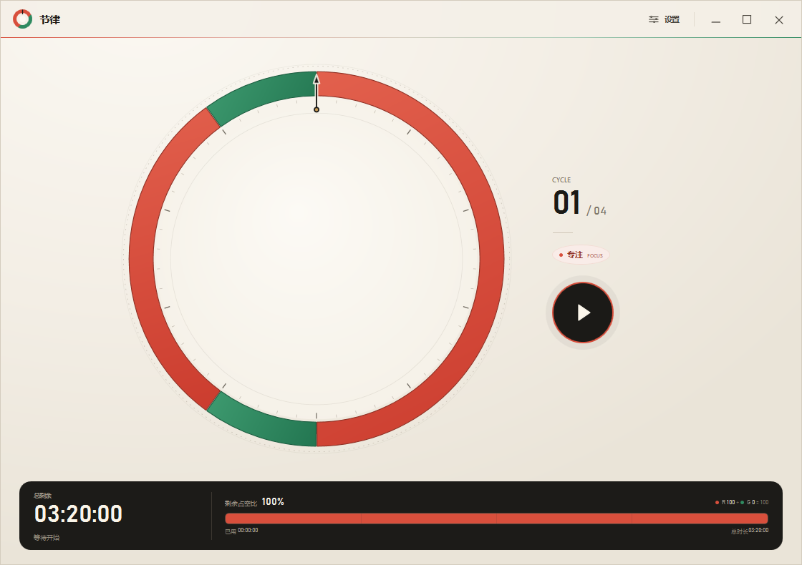
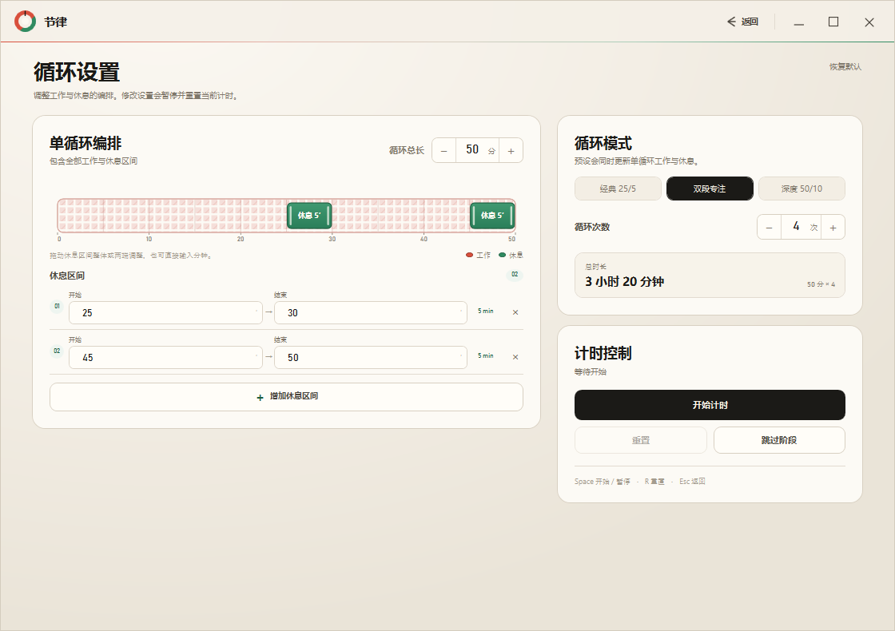

# 节律 · Rhythm Pomodoro

[](LICENSE)
[](#)
[](#)

> A native Windows Pomodoro timer built with WPF. A thin work/rest ring, Windows-native window snapping, and a remaining-time bar that shifts linearly from red to green.

原生 Windows 番茄钟，不是网页或 Electron 应用。工作 / 休息循环由细扇环、1 分钟刻度和指针构成，计时状态与循环数位于环形右侧。



## 下载 / Download

- 直接下载仓库内的单文件程序：[RhythmPomodoro.exe](RhythmPomodoro.exe)
- 或从 [Releases](https://github.com/zhll666/rhythm-pomodoro/releases/latest) 下载。
- 需要 Windows 10/11 与 [.NET 9 Desktop Runtime](https://dotnet.microsoft.com/download/dotnet/9.0)。

双击 `RhythmPomodoro.exe` 即可运行。

## 功能

- 细环形工作 / 休息盘：未来工作为带边框红色，未来休息为带边框绿色，已经过去的区间以浅色斜线表示。
- 内圈 1 分钟刻度，指针位于环与刻度内部，初始指向顶部 0°。
- 环形右侧显示 `CYCLE 01 / 04`、当前阶段胶囊（专注 FOCUS / 休息 BREAK）与开始 / 暂停按钮。
- 支持单循环多个休息区间：
  - 拖动时间轴中的休息区块整体或两端；
  - 直接输入开始 / 结束分钟；
  - 修改单循环总长；
  - 设置循环次数，总时长为循环 × 次数。
- 内置经典 25/5、双段专注、深度 50/10 三种预设，也可完全自定义。
- 下侧总时间条：左侧数字倒计时，右侧细矩形用长度和颜色同时表达剩余时间。颜色为红色分量与绿色分量的线性混合，`R + G` 始终为 100。
- 窗口贴靠完全使用 Windows 系统行为（拖动到屏幕边缘、`Win + ← / → / ↑`、Windows 贴靠布局），程序内没有自定义贴靠菜单或逻辑。
- 系统窗口按钮、双击标题栏最大化、`Esc` 返回等原生窗口操作。



## 快捷键

| 快捷键 | 行为 |
| --- | --- |
| `Space` | 开始 / 暂停 |
| `R` | 重置计时 |
| `Esc` | 从设置返回计时 |
| `Win + ← / → / ↑` | 使用 Windows 系统贴靠 |

## 构建

需要 .NET 9 SDK。

```powershell
dotnet publish native\RhythmPomodoro\RhythmPomodoro.csproj `
  -c Release -r win-x64 --self-contained false `
  -p:PublishSingleFile=true -p:IncludeNativeLibrariesForSelfExtract=false `
  -p:DebugType=None -o out
```

`out\RhythmPomodoro.exe` 即生成单文件程序。

源码位于 [`native/RhythmPomodoro`](native/RhythmPomodoro)。

## 作者

**Zhenghao Chen** · [@zhll666](https://github.com/zhll666)

## License

[MIT](LICENSE) © 2026 Zhenghao Chen
